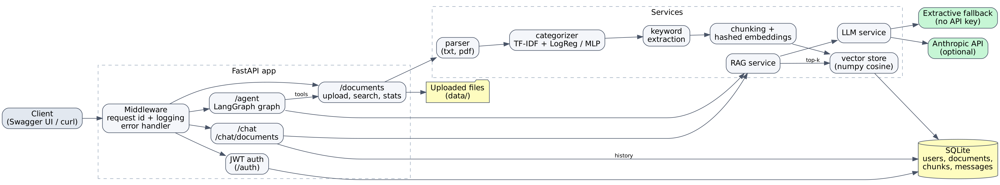

# Enterprise AI Knowledge Assistant

Capstone project for the Onshore Internship Program (8 weeks).
Upload documents, have them categorized and indexed, then ask questions about them
(RAG with sources). There's also an agent that can use tools and asks for approval before deleting anything.



## Run it

```bash
python3 -m venv venv
source venv/bin/activate
pip install -r requirements.txt
cp .env.example .env      # set JWT_SECRET, optionally ANTHROPIC_API_KEY
uvicorn app.main:app --reload
```

Open `http://localhost:8000/docs`. Register at `/auth/register`, log in at `/auth/login`,
then click Authorize and paste the token.

Tests: `python -m pytest` (48 tests). Docker: see [DEPLOYMENT.md](DEPLOYMENT.md).

## What it does

- Upload .txt / .pdf, text extraction, auto category (resume / meeting_notes / report / contract / other), TF-IDF keywords
- Chunking + embeddings + vector search over your uploaded docs
- `/chat` plain chat with conversation memory, `/chat/documents` answers from your docs with sources
- `/agent/run` LangGraph agent: search docs, list docs, stats, delete (needs approval via `/agent/approve`)
- JWT login, every user only sees their own documents
- Request logging, error handling, Swagger docs, Docker

More detail in [docs/TECHNICAL.md](docs/TECHNICAL.md).

## Things to know (limitations)

- Without `ANTHROPIC_API_KEY` the answers are extractive: it picks the best matching sentences from your docs, it does not write new text. The Anthropic code path is unit tested with a fake client only, I haven't run it against the live API
- Embeddings are hashed words/bigrams with crude stemming. They match on shared wording, not meaning, so synonyms won't match. A real embedding model would be the next upgrade (only `embedding_service.embed()` changes)
- The vector store loads a user's chunks and does one numpy matrix product. Fine for hundreds of docs, not for millions
- Classifier training data is small and partly synthetic. 80% on my own held-out test set does not mean 80% on real company documents
- No torch in my setup so no CNN/LSTM, the week 4 neural nets are numpy and sklearn
- Dockerfile and compose file are written but I could not build them where I developed this, so test `docker compose up` on your machine
- Agent state uses an in-memory checkpointer, pending approvals are lost on restart

## Numbers I measured

- Document categorizer: 80% accuracy on 50 held-out self-written docs
- Retrieval on 5 policy docs and 15 questions I wrote (`python scripts/eval_retrieval.py`): correct doc ranked 1st for 12/15, in the top 3 for 15/15
- Digit recognizer (numpy neural net from scratch): 96.9% on the sklearn digits test split
- Week 4 text classifier on unseen phrasing: logreg 54%, MLP 55%, so the MLP is not really better here

## Progress Log

- **Week 1** — Repo structure, Git workflow, FastAPI skeleton, document upload + parsing (txt/pdf), pandas-based stats endpoint
- **Week 2** — ML exercises (spam classifier, customer prediction, data viz), document categorization wired into the app
- **Week 3** — NLP exercises (resume classifier, sentiment analyzer, keyword extractor), automatic keyword extraction wired into document upload
- **Week 4** — Neural net from scratch (digits), MLP text classifier as an option for the categorizer, sqlite storage + pytest suite
- **Week 5** — LLM service (Anthropic + extractive fallback), prompt experiments, chat endpoint with conversation memory
- **Week 6** — Chunking, embeddings, numpy vector store, search, RAG chat with sources
- **Week 7** — LangGraph agent with tools and human approval for deletes
- **Week 8** — JWT auth, per-user data, logging, error handling, Swagger docs, Docker
